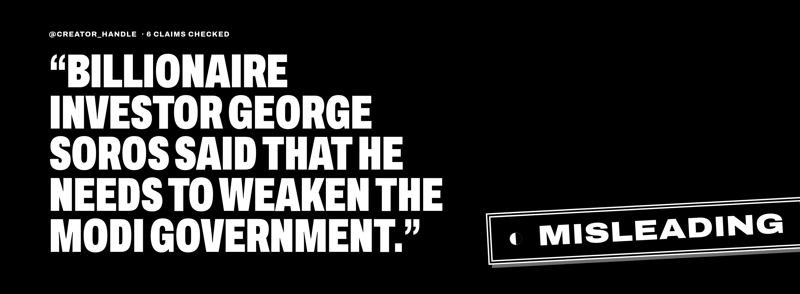
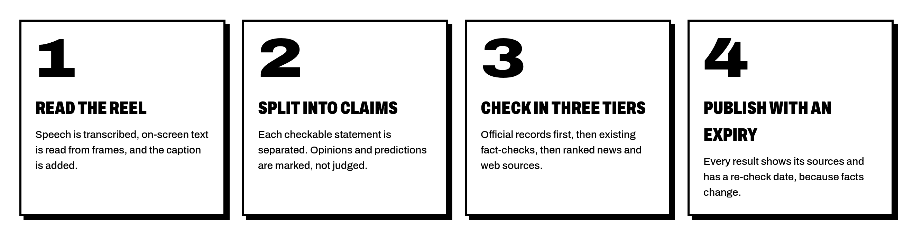
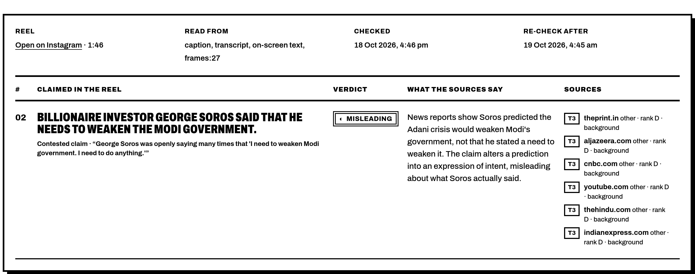
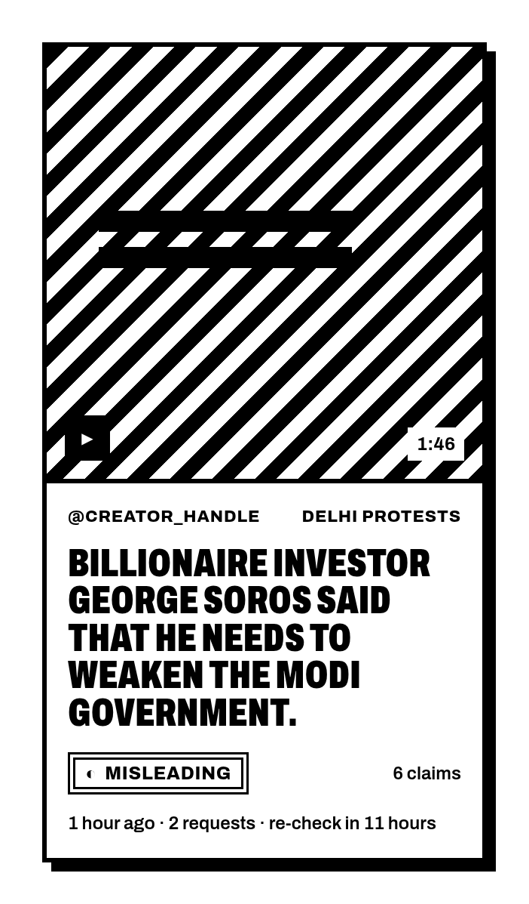
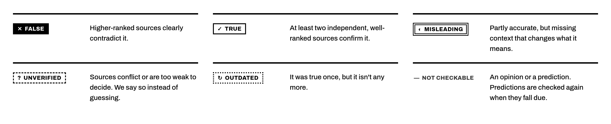
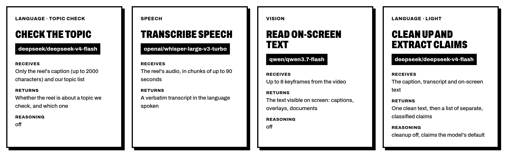

<div align="center">


**The fact checker for the reels in your feed.**
Paste a link. We watch it, read it, hear it, and check every single claim against real sources.

<br>


<br>



</div>

---

## 🎬 Ninety seconds of video. Six claims. Zero chill.

A reel says something with total confidence. Half a million people believe it by lunch.
**varuna** slows that down:

> 📥 **Drop in an Instagram reel link**<br>
> 👂 It **listens** to every word, **reads** every caption and every bit of on-screen text<br>
> ✂️ It **splits** what's said into separate, checkable claims<br>
> 🔎 It **hunts** for evidence: official records first, then fact-checkers, then the open web<br>
> 🏷️ It **stamps** each claim with a verdict, shows its sources, and sets a date to check again

<div align="center">

</div>

---

## 🧾 Receipts, not vibes

Every claim gets its own row: what was said (in the original language), the verdict,
**what the sources actually say**, and every source used, with its rank.
No "trust us", ever. Here, a quote that turns a *prediction* into an *intention* gets caught
as **Misleading**.

<div align="center">

</div>

<br>

<table>
<tr>
<td width="48%">

</td>
<td>

### 📰 The feed of checked reels

Everything anyone has asked about, newest first. Every card leads to the full check.

### ⏳ Facts have a shelf life

Breaking news gets re-checked in **hours**. Developing stories in **days**. Settled history in
**weeks**. When a result expires, the next person who asks triggers a fresh check, and the
old verdict is kept so you can see how the story changed.

### 🙅 Nobody can bribe the order

Sources are ranked in a public file anyone can read and argue with. Higher rank wins conflicts.
Government sources settle whether a notice exists; on contested political claims they're
one voice, not the final word.

</td>
</tr>
</table>

---

## 🏷️ Six verdicts. Each one wears its own mark.

So none of them rely on colour alone.

<div align="center">

</div>

> [!IMPORTANT]
> **"True" and "False" must be earned.** Each needs at least two independent organisations that
> directly back it up. Not enough? It's **Unverified**, and we say so instead of guessing.
> Sarcasm, jokes and exaggeration are read for what they *mean*, not what they literally say.

---

## 🔍 Nothing hidden

The `/transparency` page shows **every AI model, every setting and every word of every prompt**
behind each verdict, generated live from the configuration the system actually runs on.
Change a model, and the page changes with it.

<div align="center">

</div>

---

## 💸 Built not to burn money

- 🚪 **Off-topic reels are turned away at the door.** The caption is checked against the topics
  varuna covers before anything is downloaded, so random content can't eat the budget.
- ♻️ **Ask twice, pay once.** If someone already checked a reel (or the same claim in another reel),
  you get that result.
- 🆓 **Free search built in.** A self-hosted search engine and a headless browser come in the box,
  so paid search APIs are optional. If one source gets blocked, the next one takes over.

---

## 🚀 Run your own

Everything runs in Docker. Copy `config.example.yaml` to `config.yaml`, add your keys, and:

```bash
docker compose up -d --build
```

Then open **http://localhost:8080** 🎉

📖 The full guide (setup, keys, services, logs, commands) lives in **[docs/SETUP.md](docs/SETUP.md)**.

---

## 🤝 Help make it better

- 🏛️ **Think a source is ranked wrong?** The rankings live in
  [`data/source_rankings.yaml`](data/source_rankings.yaml), each with a written reason. Open a PR.
- 🗣️ **Think a verdict is wrong?** Every result page has a *Dispute* button. Bring evidence.
- 🧠 **Think a prompt could be smarter?** They're all in [`prompts.yaml`](prompts.yaml), in plain English.

<div align="center">

<br>

### ⚡ Before you forward it, *varuna* it. ⚡
</div>
