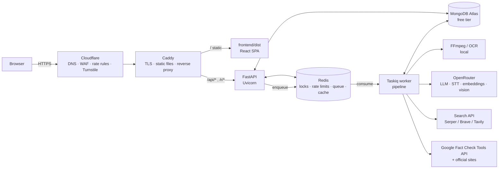
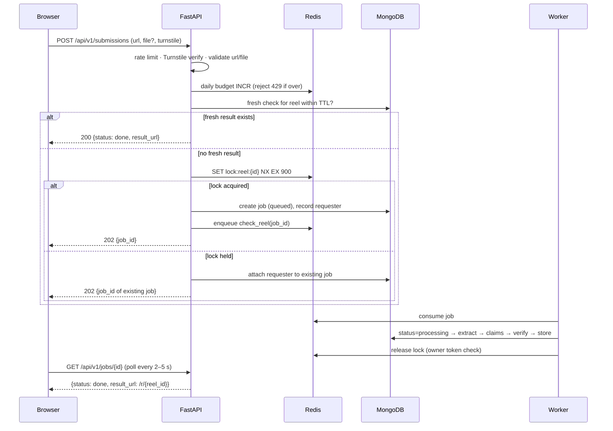

# varuna fact checker: Technical Design (Phase 1)

> Companion to [varuna-project-flow.md](varuna-project-flow.md). The flow doc says **what** we build. This doc says **how**: every framework, library, service and convention, for review before any code is written.

**Status:** Phase 1 built (see "As built" below) · **Scope:** Phase 1 (core pipeline + public website, Google sign-in for submitting)

**Visual prototype:** [index.html](index.html) shows the six design directions; **#4 Poster** was chosen.

---

## As built (supersedes the sections below where they differ)

Decisions made after review, and what the code actually does. Run instructions are in the [README](../README.md).

| Topic | Original plan in this doc | As built |
|---|---|---|
| Configuration | `.env` + pydantic-settings | **`config.yaml` at the repo root**, validated by Pydantic and **read fresh on every access** (no caching), so edits apply without a restart. Invalid saves fall back to the last valid version. `config.example.yaml` is committed; `config.yaml` is gitignored |
| Auth | None; optional invite code + Turnstile | **Google sign-in** (Google Identity Services ID token, verified against Google's keys) → our own **JWT (subject = email, 24 h, configurable)** in an httpOnly cookie. Gates **submitting only**; reading stays public. Allowed emails: `auth.invited.mail`; `auth.invited.instagram` is stored for the Phase 2 bot. The invite list is re-checked on every request. Turnstile dropped |
| Design | Choose one of six | **#4 Poster** (Archivo variable width) |
| Redis | One instance | **Two containers**: `redis-queue` (queue, locks, rate limits, budget, log events; `noeviction`, AOF) and `redis-cache` (200 MB, `allkeys-lru`, no persistence) so eviction can never drop a job |
| Inter-service calls | n/a | **Only Redis**: job stream and log list. No RPC or REST between services |
| Job queue | Taskiq | **Own Redis Streams consumer group** (`app/queue.py`): ack-based, restarts resume own pending jobs, stale jobs reclaimed after the lock TTL, retries via a delayed sorted set with configurable backoff |
| Rate limiting | SlowAPI | **Own fixed-window limiter** in `redis-queue` (`app/ratelimit.py`) so rules come from `config.yaml` per request. Per IP for reads/auth/jobs/disputes, per signed-in email for submissions, plus the daily budget |
| MongoDB indexes | Several, incl. TTL | **None created** (free-tier storage). Reels use the shortcode as `_id`, creators the handle, claims a text hash, so key lookups use the built-in `_id` index; everything else scans and is cached in `redis-cache`. Old jobs/requests are deleted by worker housekeeping instead of TTL indexes |
| History / TTL | Separate `checks` collection | **One document per reel**: `current` + `history[]`. An expired result is moved into `history` on the next check and replaced; nothing is deleted. TTL per volatility (`ttl.*`), history cap and raw-text retention (`history.*`) are configurable |
| Submissions | Link + optional video upload | **Link only.** Video downloaded with **instaloader** (logged-in throwaway account, session saved in a volume), **yt-dlp** as automatic fallback; order configurable |
| OCR | RapidOCR first, vision fallback | **Vision model on keyframes** (`pipeline.ocr.engine: vision`), no local OCR dependency |
| Transcription | OpenRouter STT, base64 JSON | **OpenRouter `POST /audio/transcriptions`** with Whisper (`pipeline.transcription.api: stt`), base64 MP3 chunks, language auto-detected unless set. `api: chat` switches to an audio-capable chat model instead |
| Models | Unspecified | Low-cost while donation-funded: **Whisper Large V3 Turbo** (speech), **Qwen 3.7 Flash** (on-screen text), **DeepSeek V4 Flash** (cleanup, claims and verdicts). All in `openrouter.models`; every check stores the models it used |
| Transparency | Not planned | **`/transparency` page** generated from `config.yaml` via `GET /api/v1/transparency`: models with links, the full flow with live settings, what's kept or deleted, limits, and the prompts verbatim. Built from an allowlist of non-secret fields (tested) |
| Logging | structlog to stdout | **Custom async logger** → Redis list → **logger service** → SQLite file with one table `website_logs(trace_id, timestamp, log_level, message)`. Levels: debug, info, error. Trace ID created per request in middleware, returned as `X-Trace-Id`, carried into queued jobs. Never blocks; if Redis is down events go to stdout |
| Admin log viewer | Not planned | **`/admin/logs`**, only for `auth.admins` (404 for everyone else, API included): search by trace ID, by reel (trace IDs from its jobs and log lines), or by time range with presets/custom dates; level, source and text filters; business-critical tab. API reads the SQLite file read-only via the shared volume (no inter-service call). SQLite has indexes on timestamp and trace_id (local disk, not Atlas) |
| Topic gate | Not planned | **Caption check before any spend**: the worker reads reel details without downloading, the small model decides whether the caption matches `topics`; off-topic reels end as `rejected` (budget slot refunded, decision remembered on the reel for `topic_gate.remember_hours` unless the topic list changes). Pipeline v0.2.0, prompts v2 |
| Prompts | Versioned `.md` files in the code | **`prompts.yaml` at the repo root**, hot-reloaded and validated (allowed/required placeholders per prompt, last valid version kept on error). Stored version = `version` + content hash. v4: sarcasm/hyperbole/quote handling (`delivery` on each claim), country and place always named, sources about a different country/time/event excluded, publication dates shown to the model |
| Verdict research | One search pass | **Up to `verification.research.max_rounds` (3) search rounds per claim.** Each round the strong model gives a verdict on the evidence so far plus up to `queries_per_round` follow-up searches built from what it found; new sources are appended (ids stay stable) until it's satisfied, nothing new turns up, or the last round. Each claim stores the searches made and the number of rounds |
| Admin records | Not planned | **`/admin/records`** (admins only): every reel document with state, verdict, claims, history and runs; raw JSON; delete one to re-check from scratch. Deleting also undoes the creator's counts, deletes claims only that reel made and expires shared claims' cached verdicts; jobs, requests, disputes and logs stay. Refused while a run holds the reel's lock |
| Web search | One paid API (Serper/Brave/Tavily) | **Fallback chain** (`search.providers`): **Serper** (free credits) → self-hosted **SearXNG** container asked one engine at a time (Google → DuckDuckGo; Bing dropped, it answers for the first word only) → **Selenium** with headless Chromium in the worker image (DuckDuckGo → Bing → Google). Failing engines get a cooldown; Tavily/Brave APIs remain available as providers |
| Business-critical log | n/a | Second SQLite table **`business_critical(timestamp, trace_id, search_engine, event, detail)`**, fed through its own Redis list. One row when an engine starts failing, one when it recovers (state kept in the queue Redis), plus `all-search-providers` when the whole chain fails. Email alerting is future scope |
| Errors | RFC 9457 problem+json | FastAPI's default `{"detail": "..."}` |
| Frontend tooling | pnpm, CSS Modules, openapi codegen, Radix, RHF/Zod, Biome | **npm**, one global stylesheet ported from the prototype, hand-written API types, no extra UI libraries. React 19, React Router (data mode), TanStack Query, Vite |
| Not built yet | — | Open Graph injection for `/r/:id`, human review script, CI workflow, Playwright tests, OG images |

---

## Contents

1. [Phase 1 scope](#1-phase-1-scope)
2. [Architecture](#2-architecture)
3. [Repository layout](#3-repository-layout)
4. [Backend](#4-backend)
5. [Frontend](#5-frontend)
6. [Design system](#6-design-system)
7. [Design directions in the prototype](#7-design-directions-in-the-prototype)
8. [Local development](#8-local-development)
9. [Deployment, CI & operations](#9-deployment-ci--operations)
10. [Build order after approval](#10-build-order-after-approval)
11. [Changes and clarifications to the flow doc](#11-changes-and-clarifications-to-the-flow-doc)
12. [Decisions needed from you](#12-decisions-needed-from-you)
13. [Out of scope for Phase 1](#13-out-of-scope-for-phase-1)

---

## 1. Phase 1 scope

| In | Out (later phases) |
|---|---|
| Public website: latest checks, hero claim, result pages, topic filters, search, creator pages, verdict legend, methodology, source ranking | Instagram mention bot and webhooks (Phase 2) |
| Submission from the website: reel link + optional video file / screen recording | User accounts, login, admin auth |
| Full pipeline: extraction → cleanup → claim extraction → 3-tier verification → store with TTL | Vector database |
| Per-reel locking, job queue, result caching, verdict history | Telegram bot (optional, can be added after M4) |
| Rate limits on every endpoint plus a global daily check budget | Donations and payments |
| Dispute form for creators/readers (no login, Turnstile-protected) | Human review dashboard UI (Phase 1 review happens directly in the DB or a script) |

**No auth in Phase 1** means no accounts or sessions. Abuse is held back by Cloudflare Turnstile, per-IP rate limits, a global daily budget, and optionally a shared invite code (see [§12](#12-decisions-needed-from-you)).

---

## 2. Architecture



All of this runs on one DigitalOcean droplet with Docker Compose (Caddy, API, worker, Redis). MongoDB is Atlas (external). The frontend is a static build served by Caddy from the same origin, so production needs no CORS.

### 2.1 Submission request lifecycle



---

## 3. Repository layout

The backend lives at the repo root (`project-varuna/`) as you asked. The frontend lives in `frontend/`.

```
project-varuna/
├── main.py                     # ASGI entry: `app = create_app()`; run with `fastapi dev main.py`
├── pyproject.toml              # uv-managed; deps, ruff, mypy, pytest config
├── uv.lock
├── .python-version             # 3.13
├── .env.example                # every env var, no secrets
├── .gitignore                  # .env, frontend/dist, __pycache__, media tmp, (font if licence requires)
├── app/
│   ├── __init__.py
│   ├── factory.py              # create_app(): middleware, routers, lifespan (Mongo/Redis clients)
│   ├── core/
│   │   ├── config.py           # pydantic-settings Settings
│   │   ├── logging.py          # structlog setup
│   │   ├── rate_limit.py       # SlowAPI limiter, key function, limit constants
│   │   ├── budget.py           # global daily check cap (Redis counter)
│   │   ├── security.py         # security headers middleware, Turnstile verify, invite code check
│   │   ├── client_ip.py        # trusted-proxy aware client IP + hashed requester key
│   │   └── errors.py           # RFC 9457 problem+json handlers
│   ├── api/
│   │   ├── deps.py             # get_db, get_redis, pagination params
│   │   └── v1/
│   │       ├── router.py
│   │       ├── health.py
│   │       ├── hero.py
│   │       ├── reels.py
│   │       ├── claims.py
│   │       ├── creators.py
│   │       ├── topics.py
│   │       ├── search.py
│   │       ├── submissions.py
│   │       ├── jobs.py
│   │       ├── disputes.py
│   │       └── sources.py
│   ├── share/
│   │   └── og.py               # GET /r/{reel_id}: SPA index.html with injected Open Graph tags
│   ├── schemas/                # API request/response models (Pydantic), versioned with the API
│   ├── models/                 # DB document models (Pydantic) + enums (Verdict, ClaimType, JobStatus)
│   ├── db/
│   │   ├── mongo.py            # AsyncMongoClient lifecycle
│   │   ├── indexes.py          # idempotent index creation at startup
│   │   └── repos/              # one module per collection: reels, claims, checks, creators, ...
│   ├── services/
│   │   ├── locks.py            # per-reel lock acquire/release (token + Lua compare-and-delete)
│   │   ├── cache.py            # fresh-result lookup, hero cache
│   │   ├── hero.py             # hero aggregation (unique requesters × distinct reels in window)
│   │   ├── creator_stats.py    # counts + min-sample rule
│   │   └── search.py           # reel URL / shortcode / @handle / text search
│   ├── pipeline/
│   │   ├── orchestrator.py     # check_reel(job_id): runs steps, updates job status, releases lock
│   │   ├── extract/
│   │   │   ├── media.py        # ffprobe validation, audio extraction (ffmpeg)
│   │   │   ├── frames.py       # interval table, scene-change sampling, pHash dedupe, frame cap
│   │   │   ├── ocr.py          # RapidOCR (default) or vision-model fallback
│   │   │   └── transcribe.py   # OpenRouter STT, base64 JSON, chunking > ~2 min
│   │   ├── cleanup.py          # small model merges OCR + transcript + caption
│   │   ├── claims.py           # split, classify, normalize, embed
│   │   ├── verify/
│   │   │   ├── official.py     # Tier 1: official/primary sources (site-restricted search + fetch)
│   │   │   ├── factchecks.py   # Tier 2: Google Fact Check Tools API, PIB Fact Check
│   │   │   ├── web.py          # Tier 3: search API with operator queries, capped per claim
│   │   │   ├── ranking.py      # loads data/source_rankings.yaml, weights by rank + source type
│   │   │   └── resolve.py      # conflict resolution → verdict, 2-independent-sources rule
│   │   └── store.py            # write check (history kept), update creator stats + topics
│   ├── integrations/
│   │   ├── openrouter.py       # chat (structured JSON), embeddings, STT, vision
│   │   ├── search/             # serper.py, brave.py, tavily.py behind one SearchProvider protocol
│   │   ├── google_factcheck.py
│   │   └── turnstile.py
│   ├── worker/
│   │   ├── broker.py           # Taskiq RedisStreamBroker + result backend
│   │   └── tasks.py            # check_reel task, retry policy
│   └── prompts/                # versioned prompt templates (cleanup.v1.md, claims.v1.md, verdict.v1.md)
├── data/
│   ├── source_rankings.yaml    # PUBLIC, versioned: domain, rank, type, rationale
│   └── topics.yaml             # launch topics (slug, title)
├── scripts/
│   ├── review_checks.py        # Phase 1 human review: list, approve, override verdicts
│   └── export_backup.py        # mongodump wrapper
├── tests/
│   ├── unit/
│   ├── api/
│   ├── pipeline/
│   └── fixtures/               # short sample videos, recorded API responses
├── deploy/
│   ├── Dockerfile              # one image for api + worker (different commands)
│   ├── docker-compose.yml      # caddy, api, worker, redis
│   ├── docker-compose.dev.yml  # redis only, for local dev
│   └── Caddyfile
├── .github/workflows/ci.yml
├── docs/
│   ├── varuna-project-flow.md
│   ├── varuna-design.md        # this file
│   └── index.html              # design prototype (6 directions)
└── frontend/                   # React app (see §5.4)
```

---

## 4. Backend

### 4.1 Runtime and tooling

| Concern | Choice | Why |
|---|---|---|
| Language | **Python 3.13** | Stable wheels for every dependency below (ONNX Runtime, OpenCV-free Pillow, PyMongo). You have 3.14 installed. We can move to 3.14 once RapidOCR/onnxruntime wheels are confirmed for it ([§12](#12-decisions-needed-from-you)) |
| Package and env manager | **uv** | Fast, lockfile (`uv.lock`), manages the Python version too. `uv sync`, `uv run …` |
| Web framework | **FastAPI** (`fastapi[standard]`) | Async, Pydantic-native, generates OpenAPI (which the frontend uses for types), includes `fastapi dev` / `fastapi run` CLI |
| ASGI server | **Uvicorn** | Comes with `fastapi[standard]`. Prod: `--workers 2 --proxy-headers --forwarded-allow-ips <caddy>` |
| Validation | **Pydantic v2** | Request/response schemas, DB documents, LLM structured outputs |
| Settings | **pydantic-settings** | Typed env config, `.env` in dev |
| Lint and format | **Ruff** | Linter and formatter in one |
| Type checking | **mypy** (strict on `app/`, Pydantic plugin) | Catches schema drift between pipeline steps |
| Pre-commit | **pre-commit** with Ruff, mypy, **gitleaks** | The repo is public, so secret scanning before every commit is required |

Exact versions are pinned in `uv.lock` at scaffold time. I'll use the latest stable release of each.

### 4.2 Libraries

| Concern | Library | Notes / alternatives considered |
|---|---|---|
| **Rate limiting** | **SlowAPI** (built on `limits`) with **Redis storage** | Decorator per route, `Retry-After` and `X-RateLimit-*` headers, shared across Uvicorn workers via Redis. *Alt:* `fastapi-limiter` (less maintained). If SlowAPI lags FastAPI releases, the fallback is a 40-line dependency on top of `limits` directly, with the same storage and the same limits |
| MongoDB driver | **PyMongo Async API** (`AsyncMongoClient`, PyMongo ≥ 4.13) | **Motor is deprecated** in favour of PyMongo's native async client. No ODM: Pydantic models + thin repository modules keep queries explicit and TTL/indexes visible. *Alt:* Beanie 2.x (ODM on PyMongo async) if we want less boilerplate |
| Redis client | **redis-py** (`redis.asyncio`) | Locks (`SET NX EX` + Lua compare-and-delete), budget counter, hero cache, rate-limit storage |
| Job queue | **Taskiq** + **taskiq-redis** + **taskiq-fastapi** | Asyncio-native, Redis Streams broker (ack-based, so jobs survive worker crashes), retries, shares FastAPI dependencies. *Alt:* ARQ (now maintenance-only), Celery (sync-first, heavier), SAQ |
| HTTP client | **HTTPX** (async) | OpenRouter, search APIs, Fact Check API, Turnstile, fetching official pages |
| Retries / backoff | **Tenacity** | Exponential backoff with jitter on 429/5xx from external APIs |
| LLM access | **OpenAI Python SDK** with `base_url=https://openrouter.ai/api/v1` | Chat completions with JSON-schema structured output, embeddings. **Raw HTTPX for speech-to-text**, because OpenRouter takes base64 audio in JSON (not multipart) with a 60 s processing limit |
| Structured LLM output | Pydantic models → JSON Schema → `response_format` | Every LLM step returns validated objects. One repair retry on schema failure, then fail the step |
| Media processing | **FFmpeg / ffprobe** (system binary, in the Docker image) via `asyncio.create_subprocess_exec` | Duration and stream validation, audio extraction (16 kHz mono), frame sampling with `fps=` per the interval table, scene detection with `select='gt(scene,0.3)'`. No extra Python video library needed |
| Frame dedupe | **Pillow** + **ImageHash** (pHash) | Drop near-duplicate frames before OCR. Hard cap of 60 frames per reel |
| OCR | **RapidOCR** (ONNX Runtime) | Light on memory compared with EasyOCR/PyTorch and fine on a 2 GB droplet. Needs a Devanagari test for Hindi on-screen text. **Fallback:** send 4–8 keyframes to a vision model on OpenRouter (the flow doc suggests this too). *Alt:* Tesseract (`pytesseract`, needs a system package, weaker on stylised overlay text) |
| Fuzzy matching | **RapidFuzz** | Repeat-claim detection on normalised text before embeddings are used |
| Embeddings | OpenRouter embeddings endpoint | Stored with every claim from day one (flow doc §7.2), no vector index yet |
| Hashing | `hashlib` (stdlib) | `normalized_hash` for claims, salted daily `requester_key` (no raw IPs stored) |
| YAML | **PyYAML** (safe_load) | `data/source_rankings.yaml`, `data/topics.yaml`, validated through Pydantic at startup |
| Uploads | `python-multipart` (in `fastapi[standard]`) | Streamed to a temp dir with a byte cap, validated by ffprobe (not just the MIME header), deleted after processing |
| Logging | **structlog** | JSON logs in prod, pretty in dev. A `job_id` / `reel_id` is bound to every pipeline log line |
| Error tracking | **sentry-sdk** (optional, free tier) | Off unless `SENTRY_DSN` is set |
| Security | Starlette `TrustedHostMiddleware`, `CORSMiddleware` (dev only), `GZipMiddleware`, custom security-headers middleware | CSP, `X-Content-Type-Options`, `Referrer-Policy`, `Permissions-Policy`; HSTS is set at Caddy/Cloudflare |
| Bot protection | **Cloudflare Turnstile** (server-side `siteverify` via HTTPX) | On `POST /submissions` and `POST /disputes` |
| Testing | **pytest**, **pytest-asyncio**, HTTPX `ASGITransport`, **respx** (mock HTTPX), **testcontainers** (real Mongo + Redis), **time-machine** (TTL/expiry tests) | Pipeline tests use recorded API fixtures. No live API calls in CI |

### 4.3 API surface (v1)

Base path: `/api/v1`. JSON throughout. Errors use **RFC 9457 `application/problem+json`**. Lists use **cursor pagination** (`?cursor=…&limit=…`, `limit ≤ 50`), keyed on `(checked_at, _id)`.

| Method | Path | Purpose | Rate limit (per client IP) |
|---|---|---|---|
| GET | `/health` | Liveness + Mongo/Redis ping | 60/min |
| GET | `/hero` | Most-checked claim in window: claim, verdict, unique requesters, distinct reels, window | 120/min |
| GET | `/reels?topic=&cursor=&limit=` | Latest analysed reels (homepage feed) | 120/min |
| GET | `/reels/{reel_id}` | Result page: claims, verdicts, sources, explanation, checked_at, expires_at, history | 120/min |
| GET | `/claims/{claim_id}` | One claim, every reel it appeared in, and its verdict history | 120/min |
| GET | `/creators?sort=claims&cursor=` | Leaderboard (counts always, ratios only when the minimum sample is met) | 120/min |
| GET | `/creators/{handle}` | Creator page: reels + counts | 120/min |
| GET | `/topics` | Topic list with counts | 120/min |
| GET | `/search?q=` | Reel URL / shortcode → exact. `@handle` → creator prefix. Otherwise claim text | **30/min** |
| GET | `/sources` | Public source ranking (from the YAML) | 60/min |
| POST | `/submissions` | `multipart/form-data`: `reel_url`, `video?`, `turnstile_token`, `invite_code?` → `202 {job_id}` or `200 {result_url}` if a fresh result exists | **5/hour, 20/day** + global daily budget |
| GET | `/jobs/{job_id}` | `queued` / `processing` (with step) / `done` / `failed` + `result_url` | 60/min |
| POST | `/disputes` | `check_id`, `message`, `contact?`, `turnstile_token` | **3/hour** |
| GET | `/r/{reel_id}` *(not under /api)* | SPA `index.html` with Open Graph tags injected, so shared links preview properly | 120/min |

Example `GET /api/v1/reels/C8xQ2pLs` response (trimmed):

```json
{
  "reel_id": "C8xQ2pLs",
  "creator": { "handle": "dailyscroll.news" },
  "permalink": "https://www.instagram.com/reel/C8xQ2pLs/",
  "duration_s": 42,
  "inputs_used": ["transcript", "ocr", "caption", "frames:34"],
  "checked_at": "2026-10-18T08:32:00Z",
  "expires_at": "2026-10-19T08:32:00Z",
  "claims": [
    {
      "claim_id": "clm_9f2c…",
      "text": "The Supreme Court has banned all protests in Delhi.",
      "type": "verifiable",
      "verdict": "false",
      "explanation": "No such order exists. The 14 October order limits gatherings at one site for 72 hours.",
      "sources": [
        { "url": "https://…", "domain": "sci.gov.in", "tier": 1, "type": "primary", "rank": "A" },
        { "url": "https://…", "domain": "pib.gov.in", "tier": 2, "type": "factcheck", "rank": "A" }
      ]
    }
  ],
  "history": [{ "checked_at": "…", "verdicts": { "false": 1, "unverified": 1 } }],
  "model_info": { "pipeline_version": "0.1.0", "prompts": { "verdict": "v1" } }
}
```

### 4.4 Rate limiting design

Three layers, from outermost in:

1. **Cloudflare (edge):** a WAF rate-limiting rule on `/api/v1/submissions` and `/api/v1/disputes`, plus bot-fight mode. This stops floods before they reach the droplet.
2. **SlowAPI (application):** per-route limits from the table above, stored in Redis so all Uvicorn workers share counters. Returns `429` as problem+json with a `Retry-After` header. Limits live in one place (`app/core/rate_limit.py`) as named constants so they can be tuned from env vars.
3. **Global daily budget (cost guard):** a Redis counter `budget:checks:{YYYY-MM-DD}` incremented only when a **new pipeline run** is enqueued (cache hits and lock joins are free). Over `DAILY_CHECK_CAP` → `429` with "Daily check limit reached, try again tomorrow". This is the hard cost cap from flow doc §11.3.

**Client IP (key function):** Uvicorn runs with `--proxy-headers` and trusts only Caddy. Caddy trusts only Cloudflare's published IP ranges, and the droplet firewall accepts 80/443 from Cloudflare only. Only then do we read `CF-Connecting-IP`. Without that chain the header could be spoofed to dodge limits.

```python
# app/core/rate_limit.py (sketch)
limiter = Limiter(
    key_func=client_ip,                    # trusted-proxy aware, see client_ip.py
    storage_uri=settings.redis_url,
    headers_enabled=True,
    strategy="moving-window",
)
READ = "120/minute"
SEARCH = "30/minute"
SUBMIT = ["5/hour", "20/day"]
DISPUTE = "3/hour"
```

**Unique-requester counting (hero section):** with no accounts, `requester_key = sha256(daily_salt + client_ip)`. The salt rotates daily and is never stored with the data, so raw IPs never reach MongoDB and keys can't be linked across days. This covers the flow doc's "count unique requesters, not raw mentions". In Phase 2 the Instagram user ID becomes the requester key.

### 4.5 Locking, caching and jobs

- **Lock:** `SET lock:reel:{reel_id} <job_token> NX EX 900`. Release with a Lua compare-and-delete so a worker can't release a lock that expired and was taken by someone else.
- **Fresh-result check first:** if the latest `checks` for the reel has `expires_at > now`, return it at once. No lock, no budget spent.
- **Lock held:** record the requester on the existing job and return its `job_id`. Everyone gets the same result.
- **Job statuses:** `queued → processing(step) → done | failed`. `step` is one of `extract`, `cleanup`, `claims`, `verify`, `store`, which drives the progress UI.
- **Retries:** Taskiq retry middleware, max 2 retries with exponential backoff, only for transient errors (network, 429, 5xx). Validation errors fail immediately. A failed job releases the lock.
- **Worker concurrency:** 2 concurrent jobs on a 2 GB droplet (FFmpeg + OCR are the memory peaks). Configurable.
- **Media hygiene:** each job works in `tmp/jobs/{job_id}/`, removed in a `finally:` block. Only text and metadata are kept (flow doc §5.3).

### 4.6 Pipeline details

| Step | Implementation | Output stored |
|---|---|---|
| Validate | ffprobe: has a video/audio stream, duration ≤ `MAX_VIDEO_SECONDS` (default 180), size ≤ `MAX_UPLOAD_MB` (default 100) | duration, dimensions |
| Frames | Interval from the flow doc §5.1 table → FFmpeg `fps` filter, plus scene-change frames → pHash dedupe → cap 60 | frame count only (frames deleted) |
| OCR | RapidOCR per kept frame, line-level text + confidence; drop low-confidence lines | `raw_ocr` |
| Transcribe | FFmpeg → 16 kHz mono → base64 → OpenRouter STT; split into ≤ 90 s chunks if longer | `raw_transcript` |
| Caption | From the submission form (Phase 1) / Graph API (Phase 2) | `caption` |
| Cleanup | Small model: merge, dedupe, keep the original language plus an English rendering | `cleaned_text` (raw kept alongside, flow doc §5.3) |
| Claims | Model returns `[{text, normalized_text, type: verifiable/contested/opinion/prediction, resolution_date?, topic_tags[]}]`; RapidFuzz + `normalized_hash` match against existing claims; embed | `claims` docs |
| Verify T1 | Site-restricted search (`site:gov.in`, `site:sci.gov.in`, `filetype:pdf`, …) + fetch top hits + model extracts relevant passages | sources (tier 1) |
| Verify T2 | Google Fact Check Tools `claims:search` (free, API key); PIB Fact Check via `site:pib.gov.in` search (PIB has no public API) | sources (tier 2) |
| Verify T3 | Search API, 3–5 operator queries per claim (cap), dedupe by domain, rank lookup | sources (tier 3) |
| Resolve | Rules first (rank order, ≥ 2 independent sources for True/False, contested → no true/false), then the strong model writes the explanation; unresolved → **Unverified** | `checks` doc |
| Store | Insert new `checks` (history never overwritten), update creator counters, topic counts, invalidate hero cache | — |

Every `checks` document records `pipeline_version`, model IDs and prompt versions, so any verdict can be audited and re-run later.

### 4.7 Data model and indexes

MongoDB Atlas free tier (512 MB). Collections follow flow doc §10, plus `jobs`, `extractions` and `disputes`.

| Collection | Key fields | Indexes |
|---|---|---|
| `reels` | reel_id, creator_handle, permalink, caption, duration_s, first_seen, last_checked_at, topic_tags | `reel_id` unique · `(creator_handle, last_checked_at -1)` · `(topic_tags, last_checked_at -1)` |
| `creators` | handle, counts {true, false, misleading, unverified, outdated, not_checkable}, reels_checked, claims_checked, last_updated | `handle` unique · `claims_checked -1` |
| `claims` | claim_id, text, normalized_text, normalized_hash, embedding?, type, resolution_date?, topic_tags, created_at | `normalized_hash` · text index on `normalized_text` · `topic_tags` |
| `checks` | check_id, claim_id, reel_id, verdict, explanation, sources[], checked_at, **expires_at**, pipeline_version, models, human_reviewed | `(reel_id, checked_at -1)` · `(claim_id, checked_at -1)` · `expires_at` (**normal index, not TTL**, see §11) |
| `extractions` | reel_id, job_id, raw_ocr, raw_transcript, caption, cleaned_text, created_at | `reel_id` · TTL on `created_at` (default 90 days, adjustable) |
| `sources` | domain, rank, type (primary/wire/outlet/factcheck/other), rationale, version | `domain` unique (synced from `data/source_rankings.yaml`) |
| `requests` | reel_id, claim_ids[], requester_key, source (web/telegram/instagram), created_at | `(reel_id, requester_key)` · `(created_at)` **TTL 30 days** |
| `jobs` | job_id, reel_id, status, step, error?, requesters[], created_at, finished_at | `job_id` unique · TTL on `created_at` 7 days |
| `topics` | slug, title, claim_count | `slug` unique |
| `disputes` | check_id, message, contact?, status, created_at | `(status, created_at)` |

**Hero query:** aggregate `requests` in the window (default 6 h) → unwind `claim_ids` → group by claim → `uniqueRequesters = $addToSet requester_key`, `distinctReels = $addToSet reel_id` → rank by `uniqueRequesters`, then `distinctReels`. The result is cached in Redis for 60 s.

**Creator ratios:** the API always returns counts. It returns ratios only when `claims_checked ≥ MIN_CREATOR_SAMPLE` (default 5, flow doc §9.3).

### 4.8 Configuration (`.env.example`)

```dotenv
APP_ENV=dev                      # dev | prod
LOG_LEVEL=INFO
PUBLIC_BASE_URL=http://localhost:5173
CORS_ORIGINS=http://localhost:5173
FORWARDED_ALLOW_IPS=127.0.0.1

MONGODB_URI=mongodb+srv://…
MONGODB_DB=varuna
REDIS_URL=redis://localhost:6379/0

OPENROUTER_API_KEY=
MODEL_SMALL=                     # cleanup, claim extraction
MODEL_STRONG=                    # contested claims, final explanations
MODEL_STT=                       # speech-to-text
MODEL_EMBED=
MODEL_VISION=                    # OCR fallback

SEARCH_PROVIDER=serper           # serper | brave | tavily
SEARCH_API_KEY=
GOOGLE_FACTCHECK_API_KEY=

TURNSTILE_SECRET_KEY=
INVITE_CODES=                    # optional, comma-separated; empty = open submissions

DAILY_CHECK_CAP=50
MAX_UPLOAD_MB=100
MAX_VIDEO_SECONDS=180
MAX_SEARCHES_PER_CLAIM=5
MIN_CREATOR_SAMPLE=5
HERO_WINDOW_HOURS=6
LOCK_TTL_SECONDS=900
SENTRY_DSN=
```

Frontend (`frontend/.env.example`): `VITE_API_BASE=/api/v1`, `VITE_TURNSTILE_SITE_KEY=`.

---

## 5. Frontend

### 5.1 Stack

| Concern | Choice | Why |
|---|---|---|
| Language | **TypeScript** (strict) | Types generated from the backend OpenAPI keep FE and BE in sync |
| UI library | **React 19** | As requested. Native `<title>`/`<meta>` support covers per-page titles |
| Build tool | **Vite** + `@vitejs/plugin-react` | Fast dev server, dev proxy `/api → :8000`, static output for Caddy |
| Rendering | **SPA** + server-injected Open Graph tags for `/r/:reelId` | Result links get shared on Instagram/WhatsApp/X, and those crawlers need meta tags. FastAPI injects them into `index.html`, which is cheaper than running a Node SSR server. *Upgrade path:* React Router framework mode with prerendering if SEO for search engines becomes a priority |
| Routing | **React Router v7** (data mode: `createBrowserRouter`, lazy routes, loaders) | Route-level code splitting, `errorElement` per route, URL search params as filter state |
| Server state | **TanStack Query v5** | Caching, background refresh for the hero, `refetchInterval` polling for job status, `useInfiniteQuery` for "Load more" |
| API client | **openapi-typescript** + **openapi-fetch** | `pnpm gen:api` reads `http://localhost:8000/openapi.json` → `src/api/schema.d.ts`. Typed requests, no hand-written DTOs |
| Forms | **React Hook Form** + **Zod** (`@hookform/resolvers`) | Submit and dispute forms, client-side validation that mirrors the server rules |
| Accessible primitives | **Radix UI Primitives** (DropdownMenu, Dialog, Tooltip, ToggleGroup, VisuallyHidden) | Unstyled and accessible. All visuals come from our CSS |
| Icons | **Lucide React** | Monochrome stroke icons, tree-shaken |
| Styling | **CSS Modules** + global **design tokens** (CSS custom properties) + `clsx` | The prototype is already written as tokens + scoped CSS, so the chosen design ports over directly. No Tailwind: a strict black-and-white system needs a few tokens, not a utility palette |
| Fonts | Self-hosted `@font-face` for Neue Haas Display. **`@fontsource-variable/*`** for Google fonts | No runtime calls to Google Fonts (privacy, no third-party request) |
| Captcha | **@marsidev/react-turnstile** | Cloudflare Turnstile widget |
| Dates | `Intl.RelativeTimeFormat` / `Intl.DateTimeFormat` | "Checked 12 min ago", "Re-check after 19 Oct". No date library needed |
| Upload progress | Small `XMLHttpRequest` wrapper | `fetch` has no upload progress events |
| Package manager | **pnpm** | Fast, strict dependency resolution |
| Node | **24 LTS** | Already installed (v24.19) |
| Lint and format | **Biome** | One fast tool for lint and format. *Alt:* ESLint (flat config) + Prettier |
| Unit/component tests | **Vitest** + **React Testing Library** + `user-event` + **MSW** (mock API) | |
| E2E and accessibility | **Playwright** + **@axe-core/playwright** | Smoke flows: home → result, search, submit → job → result, keyboard-only nav |

No global state library (Redux/Zustand). Server state lives in TanStack Query, and UI state is local or in the URL.

### 5.2 Routes

| Path | Page | Data |
|---|---|---|
| `/` | Home: hero, topic chips, latest checks, how it works, verdict legend | `/hero`, `/reels`, `/topics` |
| `/r/:reelId` | Result page: claim table (claimed in reel / verdict / what sources say / sources), inputs used, checked & re-check times, history, dispute link | `/reels/{id}` |
| `/claims/:claimId` | Claim page: every reel repeating it, verdict history | `/claims/{id}` |
| `/creators` | Leaderboard: counts, ratio bar only after min sample, bias disclaimer | `/creators` |
| `/c/:handle` | Creator page | `/creators/{handle}` |
| `/t/:slug` | Topic feed | `/reels?topic=` |
| `/search?q=` | Search results (reels, creators, claims) | `/search` |
| `/check` | Submit a reel | `POST /submissions` |
| `/check/:jobId` | Job progress → redirect to result | `/jobs/{id}` (polling) |
| `/method` | Methodology: tiers, ranking, conflict rules, TTL | static + `/sources` |
| `/sources` | Public source ranking with rationale | `/sources` |
| `/verdicts` | What each verdict means | static |
| `/corrections` | Corrections and change log | static (Phase 1) |
| `/dispute` | Dispute a verdict (`?check=`) | `POST /disputes` |
| `/about` | Purpose, principles, open source, limits | static |
| `*` | 404 | — |

### 5.3 Component inventory

`AppShell` · `NavBar` · `Footer` · `VerdictBadge` · `VerdictLegend` · `HeroClaim` · `StatBlock` · `TopicChips` · `SearchBox` · `ReelCard` · `ReelGrid` (+ skeleton) · `ClaimTable` (stacks into cards on mobile) · `SourceList` · `TierTag` · `RankTag` · `ExpiryNote` ("re-check after …") · `VerdictHistory` · `CreatorRecordBar` · `LeaderboardTable` · `MinSampleNotice` · `SubmitForm` · `FileDrop` · `TurnstileField` · `JobProgress` · `DisputeForm` · `EmptyState` · `ErrorState` · `LoadMore`

### 5.4 Frontend layout

```
frontend/
├── fonts/
│   └── NeueHaasDisplay-Roman.woff2
├── public/
│   ├── favicon.svg
│   └── og-default.png
├── index.html
├── package.json
├── pnpm-lock.yaml
├── vite.config.ts              # react plugin, /api proxy → http://localhost:8000
├── tsconfig.json
├── biome.json
├── playwright.config.ts
└── src/
    ├── main.tsx                # QueryClientProvider + RouterProvider
    ├── router.tsx              # lazy routes
    ├── api/
    │   ├── schema.d.ts         # generated by openapi-typescript (never edited by hand)
    │   ├── client.ts           # openapi-fetch instance, problem+json → typed errors
    │   └── queries.ts          # query keys + hooks (useHero, useReels, useJob …)
    ├── styles/
    │   ├── fonts.css           # @font-face
    │   ├── tokens.css          # colour, type, space, radius, border, motion tokens
    │   └── global.css          # reset, base elements, focus styles
    ├── components/             # shared components (each: Component.tsx + Component.module.css)
    ├── pages/                  # one folder per route
    ├── features/
    │   ├── submit/             # form, upload, job polling
    │   └── creators/           # leaderboard logic, min-sample rules
    ├── lib/                    # format (relative time, counts), url parsing (reel shortcode)
    └── test/                   # MSW handlers, test utils
```

### 5.5 Frontend conventions

- **URL holds filter state:** `/?topic=delhi-protests&q=@dailyscroll`. Shareable and back-button safe.
- **Loading:** skeletons shaped like the final layout, no spinners on page load. Hero data refreshes every 60 s.
- **Errors:** route `errorElement` shows a readable message. A `429` shows "You're going a bit fast, try again in N s" using `Retry-After`.
- **Performance budget:** initial JS ≤ 150 KB gzipped, LCP ≤ 2.5 s on mid-range 4G, fonts preloaded with `font-display: swap`, route-level code splitting.
- **Accessibility:** WCAG 2.2 AA. Verdicts never rely on colour (there is none) or shape alone: every badge has a glyph, a word and a distinct border treatment (§6.4). Full keyboard support, visible focus rings, `prefers-reduced-motion` respected.
- **Analytics:** none in Phase 1. If added later, self-hosted and cookieless (Umami or Plausible).

---

## 6. Design system

### 6.1 Principles

1. **Black and white only.** Hierarchy comes from size, weight, space and line, never colour. Greys are tints of black for secondary text and hairlines only.
2. **Modern and minimal.** Few elements, generous space, strict alignment to a grid.
3. **Sources are first-class.** A verdict never appears without a way to see its sources within one click.
4. **Claims, not people.** Creator data is framed as "claims checked" with counts and sample-size notes.

### 6.2 Tokens

```css
:root {
  /* colour: the whole palette */
  --bg: #ffffff;   --fg: #000000;
  --muted: #6e6e6e;          /* secondary text, AA on white */
  --line: #d9d9d9;           /* hairlines */
  --line-strong: #000000;    /* rules, borders that carry meaning */
  --soft: #f2f2f2;           /* hover / subtle fill */

  /* type */
  --font-body: "Neue Haas Display", "Helvetica Neue", Helvetica, Arial, sans-serif;
  --fs-xs: 12px; --fs-sm: 14px; --fs-md: 16px; --fs-lg: 20px;
  --fs-xl: clamp(28px, 3.5vw, 44px); --fs-hero: clamp(40px, 6.5vw, 100px);

  /* space (4 px base) */
  --s-1: 4px; --s-2: 8px; --s-3: 12px; --s-4: 16px; --s-6: 24px; --s-8: 32px; --s-12: 48px; --s-16: 64px; --s-24: 96px;

  /* shape, line, motion */
  --radius: 0; --border: 1px;
  --ease: cubic-bezier(.2, 0, 0, 1); --dur: 150ms;
}
```

Final values depend on which design you pick. Each direction in the prototype is one set of these tokens plus a few layout rules. If you want a dark mode later, it only means swapping the `--bg`/`--fg` family (the "Noir" direction shows what that looks like).

### 6.3 Layout

- 12-column grid, max width 1280 px, gutters 16 px (mobile) / 32 px (tablet) / 48 px (desktop).
- Breakpoints: 560, 720, 960, 1200 px.
- No horizontal page scroll at 320 px. Wide tables scroll inside their own container or stack into cards.

### 6.4 Verdict encoding (no colour)

| Verdict | Glyph | Badge treatment | Meaning |
|---|---|---|---|
| **False** | ✕ | **Solid fill** (inverted), the strongest mark | Higher-ranked sources clearly contradict it |
| **True** | ✓ | Solid outline | ≥ 2 independent, well-ranked sources confirm it |
| **Misleading** | ◐ | Double outline | Partly accurate, missing context that changes the meaning |
| **Unverified** | ? | Dashed outline | Sources conflict or are too weak, so we don't guess |
| **Outdated** | ↻ | Dotted outline | Was true once, isn't now |
| **Not checkable** | — | No outline, muted text | Opinion or prediction (predictions re-checked when due) |

Each design in the prototype restyles these (brackets in Terminal, pills in Noir, circles in Gallery) but keeps the same fill → outline → double → dashed → dotted → none order.

### 6.5 Fonts and licensing

- `frontend/fonts/NeueHaasDisplay-Roman.woff2` contains **one weight (Roman / 400)** and no italic. The Swiss direction builds its hierarchy from size alone and sets `font-synthesis: none` so the browser never fakes bold or italic. If you want weight contrast, we need the Medium/Bold files too.
- ⚠️ **Licence check needed.** Neue Haas Display is a commercial typeface. The repo is meant to be public and open source, and most commercial web-font licences **do not allow** redistributing the file in a public repo. Options: (a) confirm your licence allows it, (b) keep the file out of git and copy it in at deploy time, or (c) pick a free alternative with a similar feel. This matters only if you choose the Swiss direction.
- Google fonts used in the other directions are all under the SIL Open Font License and are self-hosted through Fontsource in the real app.

---

## 7. Design directions in the prototype

Open [docs/index.html](index.html). The selection is remembered (and set in the URL as `?design=…`), so you can share a link to one direction.

| # | Name | Font(s) | Character |
|---|---|---|---|
| 01 | **Swiss** | Neue Haas Display (provided) | International Typographic Style: 12-column grid, hairline rules, very large type, numbered sections, giant footer wordmark. Single weight throughout |
| 02 | **Broadsheet** | Newsreader | Newspaper front page: dateline bar, centred masthead, double rules, lead story with a stamped verdict, ruled columns, drop cap |
| 03 | **Terminal** | IBM Plex Mono | Open-source / audit-log feel: boxed panes with labels on the border, `[ FALSE ]` bracket verdicts, inverted header bars, checkboxes for filters |
| 04 | **Poster** | Archivo (variable width) | Neo-brutalist protest poster: 3 px borders, hard offset shadows, condensed uppercase headlines, black hero, scrolling verdict ticker |
| 05 | **Noir** | Geist | Dark product UI: black background, dot-grid hero, gradient-grey headline, pills, rounded cards, soft borders |
| 06 | **Gallery** | Instrument Serif + Instrument Sans | Editorial and airy: large serif headlines with italics, lots of whitespace, staggered image grid, circle verdict marks |

All six use the same content and markup, so you're comparing design rather than content. The page also shows the Phase 1 features in context: hero claim with unique-requester stats, topic filter + search (both work), a result table, how-it-works, a creator leaderboard with the min-sample rule, the verdict legend, and the submission flow with simulated job progress.

---

## 8. Local development

Prerequisites: `uv`, Python 3.13 (uv installs it), Node 24, pnpm, Docker Desktop (for Redis), FFmpeg on `PATH`.

```bash
# backend (repo root)
uv sync                                         # install deps into .venv
docker compose -f deploy/docker-compose.dev.yml up -d redis
cp .env.example .env                            # fill in Atlas URI + keys
uv run fastapi dev main.py                      # http://localhost:8000  (docs at /docs)
uv run taskiq worker app.worker.broker:broker   # pipeline worker (second terminal)

# frontend
cd frontend
pnpm install
pnpm gen:api                                    # regenerate types from the running backend
pnpm dev                                        # http://localhost:5173  (proxies /api → :8000)

# quality
uv run ruff check . && uv run ruff format --check . && uv run mypy app && uv run pytest
pnpm biome check && pnpm tsc --noEmit && pnpm test && pnpm e2e
```

---

## 9. Deployment, CI & operations

| Area | Plan |
|---|---|
| Host | DigitalOcean droplet, **2 GB** (1 GB is too tight once FFmpeg + OCR run), Ubuntu LTS, SSH-key only, unattended security upgrades |
| Containers | `deploy/docker-compose.yml`: **caddy** (TLS + static `frontend/dist` + reverse proxy), **api** (Uvicorn, 2 workers), **worker** (Taskiq, concurrency 2), **redis** (`redis:7-alpine`, AOF on, `maxmemory` set). One Docker image for api + worker, with FFmpeg and ONNX Runtime included |
| Edge | Cloudflare proxied DNS, TLS Full (strict), WAF rate rules, Turnstile, cache static assets. The droplet firewall allows 80/443 from Cloudflare IP ranges only (hides the origin, flow doc §12) |
| CI | GitHub Actions on every PR: Ruff, mypy, pytest (testcontainers), Biome, `tsc`, Vitest, Vite build, Playwright smoke, **gitleaks**. Dependabot for both ecosystems |
| CD | Phase 1: build image in Actions → push to GHCR → `ssh deploy && docker compose pull && up -d`. Manual trigger |
| Backups | Atlas free tier has no backups → nightly `mongodump` (cron on the droplet) to DigitalOcean Spaces, keep 14 days. Also covers flow doc §14 "regular data export" |
| Secrets | `.env` on the droplet only (chmod 600). GitHub Actions secrets for deploy. Nothing in the repo, and gitleaks enforces it |
| Monitoring | `/api/v1/health` checked by a free uptime monitor. Sentry optional. Daily budget usage logged |

---

## 10. Build order after approval

| Milestone | Delivers |
|---|---|
| **M0 · Scaffold** | uv + FastAPI app factory, settings, logging, problem+json errors, `/health`; Vite + React + router + tokens from the chosen design; CI, pre-commit, gitleaks; dev Redis |
| **M1 · Read side** | Mongo models, indexes, seed script; `/hero`, `/reels`, `/reels/{id}`, `/claims/{id}`, `/creators`, `/topics`, `/search`, `/sources` with rate limits; Home, Result, Creator, Topic, Search, Verdicts, Method pages on seeded data |
| **M2 · Submission** | `/submissions` (upload, Turnstile, optional invite code, daily budget), locking, Taskiq job with stub pipeline, `/jobs/{id}`, Submit + Job progress pages, `/r/{id}` OG injection |
| **M3 · Extraction** | ffprobe validation, frames + dedupe, OCR, STT, cleanup; raw + cleaned stored; media deleted |
| **M4 · Verification** | claim extraction/classification, 3 tiers, source ranking YAML, conflict resolution, verdict + explanation, TTL, history, creator/topic counters |
| **M5 · Trust features** | hero aggregation, min-sample creator ratios, disputes, corrections page, review script for human verification |
| **M6 · Hardening** | test coverage on pipeline + API, Playwright + axe, load test of rate limits, Docker deploy, Cloudflare, backups, 50-reel evaluation run (flow doc §13) |

---

## 11. Changes and clarifications to the flow doc

1. **TTL vs history.** Flow doc §7.1 suggests MongoDB TTL indexes to expire records, and §4.3/§10 say to keep verdict history. A TTL index **deletes** documents, so putting one on `checks` would erase history. **Decision:** `checks.expires_at` is a normal indexed field that marks a verdict *stale* (triggering a re-check on the next request). TTL deletion only applies to bulky or ephemeral data: `requests` (30 d), `jobs` (7 d), `extractions` raw text (90 d, adjustable).
2. **"Invite-only" with no auth.** Phase 1 is invite-only in the flow doc, but you asked for no auth. **Proposal:** an optional shared invite code (env `INVITE_CODES`, checked on submit only, no accounts), plus Turnstile, rate limits and the daily budget. Reading the site stays fully public.
3. **Motor → PyMongo async.** Motor (the usual async Mongo driver) is deprecated. We use PyMongo's native async client instead.
4. **Reel video source in Phase 1.** We don't download from Instagram (ToS risk, and unreliable). Submitters attach the video file or a screen recording, as flow doc §13 Phase 1 suggests. With only a link, the pipeline can use the caption the submitter pastes, but the result is marked as a partial check.
5. **Requester identity without accounts:** salted, daily-rotating hash of the client IP (§4.4). Good enough for "unique requesters" without storing personal data.
6. **Extra collections:** `jobs`, `extractions`, `disputes`, not listed in flow doc §10.
7. **Audit fields:** every check stores pipeline version, model IDs and prompt versions.

---

## 12. Decisions needed from you

| # | Question | My recommendation |
|---|---|---|
| 1 | **Which design direction** (01–06), or which mix? | Your call after toggling the prototype |
| 2 | Submission gate with no auth: open + Turnstile, or also a **shared invite code**? | Invite code for Phase 1 (matches the flow doc), removable by clearing the env var |
| 3 | Accept **video uploads** in Phase 1? Limits of 100 MB / 3 min OK? | Yes, it's the only reliable input without Instagram API access |
| 4 | **Neue Haas Display licence** for a public repo (only matters if you pick 01) | Confirm the licence, or keep the file out of git |
| 5 | OCR: **local RapidOCR** or **vision model** only? | RapidOCR first, vision model as fallback. Decide after testing on 10 real reels with Hindi text |
| 6 | Search API: **Serper**, **Brave** or **Tavily**? Which OpenRouter models? | Decide after a cost test on ~20 reels (flow doc §15). The code supports all three behind one interface |
| 7 | Repo **licence** | **AGPL-3.0** if you want hosted forks to stay open; MIT if you want maximum reuse |
| 8 | Python **3.13** or **3.14**? | 3.13 now, move up once wheels are confirmed |
| 9 | Light only, or a **dark mode** toggle too? | Light only for Phase 1 unless you pick Noir |

---

## 13. Out of scope for Phase 1

Instagram webhooks and the mention bot · user accounts / admin auth · vector database · Telegram bot (can follow M4) · donations · multi-language UI (content may be Hindi/English, UI is English) · native apps · real-time push (polling is enough at this scale).
