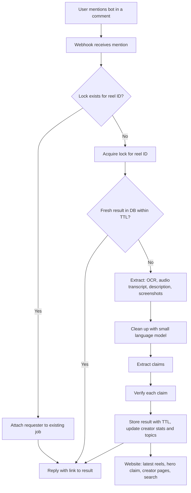

# Varuna: Project Flow & Reference Doc

> *Question before you believe.*

Working doc for building the reel fact-checking bot and its public website. Everything marked **(Suggested)** is an addition or default value from design review and can be changed. Everything else comes from the original project description.

---

## 1. Purpose

Misinformation and propaganda spread quickly through short-form video, especially around protests and political events. Creators (including some independent journalists) may report false or paid-for information, so users need a fact-checker within reach instead of relying only on content creators.

**What it does:** When someone mentions the bot's handle in a comment on any Instagram post or reel, a pipeline extracts exactly what the reel claims, verifies those claims against trusted sources, and publishes the result on a public website.

**What it is not:** A tool that rules on opinions, a replacement for professional fact-checkers, or a way to judge people's character. It reports on claims, with sources shown.

---

## 2. Name, Tagline & Principles

| Item | Decision |
|---|---|
| Name | **Varuna** (Vedic deity of truth and moral order). Still to check: handle availability, domain, name collisions, and the religious-branding trade-off |
| Tagline | Leaning toward **"Question before you believe"**. Alternatives: "Doubt every claim, check the source", "Question. Verify. Believe.", "Doubt every claim, including ours" |
| Open source | Code is public so people can judge whether to trust it |
| Funding | Invite-only first, expand as donations cover infrastructure |

**Operating principles**

1. Every verdict shows its sources.
2. Judge claims, not people.
3. Do not trust any source blindly. Even news agencies can be paid, so trust is ranked and not assumed.
4. When the evidence conflicts and can't be resolved, say **Unverified** instead of guessing.
5. Verdicts expire. A claim checked five days ago may have become true (or false) since.
6. **(Suggested)** The project's public identity is kept separate from the builder's personal identity (see section 12).

---

## 3. System Overview

**Verification order for each claim**

1. Trusted official sources (government sites, notices, court orders)
2. Existing fact-check tools (PIB Fact Check, Google Fact Check Tools, and similar)
3. Independent web search (search engines and operator-based "dorking"), with every source weighted by credibility rank
4. Resolve by rank; if still conflicting, mark **Unverified**

---

## 4. Trigger & Locking

### 4.1 Trigger
- A user mentions the bot handle in a comment on any post or reel.
- The mention arrives as a webhook event, and the reel is identified by its ID (for example, the shortcode from its permalink).

### 4.2 Per-reel lock
**Goal:** Many people mentioning the bot on the same reel must start only one fact check.

**(Suggested) Implementation:**
- Redis key `lock:reel:{reel_id}` set with `SET NX` and an expiry (for example, 10-15 minutes) so a crashed worker cannot block the reel forever.
- First mention acquires the lock and enqueues the job.
- Later mentions of the same reel do not start new work. They are recorded as additional requesters on the existing job, so everyone gets the same result when it finishes.
- Job statuses: `queued`, `processing`, `done`, `failed`. A failed job releases the lock and may be retried a limited number of times.
- Log each mention with a requester ID. The hero section uses unique requesters, not raw mention counts (see 9.2).

### 4.3 Cache check before any work
- If a result for this reel exists and is still inside its TTL, skip the pipeline and reply with the existing result.
- If the TTL has expired, re-run the check. The old result is kept in history rather than overwritten, so the website can show how the verdict changed.

---

## 5. Extraction: What the Reel Is Actually Claiming

For each reel, collect all of these so the pipeline has exactly what is being claimed:

| Input | Method |
|---|---|
| On-screen text | OCR over video frames |
| Spoken content | Audio transcript (speech-to-text) |
| Description / caption | Text from the post |
| Visual context | Screenshots at set intervals |

### 5.1 Screenshot intervals
Shorter reels get a tighter interval and longer reels a wider one, so cost stays predictable.

**(Suggested) starting values, tune after real tests:**

| Reel length | Frame interval |
|---|---|
| Up to 15 s | every 0.5 s |
| 15-60 s | every 1 s |
| 60-180 s | every 2 s |
| Over 180 s | every 3-5 s |

Cost controls: remove near-duplicate frames and run OCR only on frames that changed (scene-change detection), and set a maximum number of frames per reel.

### 5.2 Transcription
- OpenRouter offers a speech-to-text endpoint. Audio is sent as base64 in JSON (not multipart like the OpenAI SDK), the processing timeout is 60 seconds, and URL input is not supported.
- A reel of up to a couple of minutes should fit. Chunk the audio for anything longer.

### 5.3 Cleanup
- A **small language model** merges the OCR text, transcript and description into one clean, deduplicated text.
- **(Suggested)** Always store the raw transcript and OCR output next to the cleaned version, so errors introduced by the cleanup step can be audited.
- Media files (video, frames) are deleted after processing. Only extracted text and metadata are kept.

---

## 6. Claim Extraction & Verification

### 6.1 Claim extraction (Suggested)
- Split the cleaned text into separate checkable claims. One reel can contain several claims, and each gets its own verdict.
- Classify each claim before verifying:
  - **Verifiable fact** (for example, "the Supreme Court banned protests"): check it
  - **Contested or interpretive claim:** present sources from multiple sides, do not issue true/false
  - **Opinion or prediction:** not checkable now; predictions are re-checked on their resolution date
- Normalize each claim into a short, canonical sentence. This is what gets stored, matched and displayed.

### 6.2 Verification pipeline

**Tier 1: Trusted official sources**
- Government websites, official notices, gazettes, court orders and other primary documents.
- These settle claims about whether an order, rule or notice exists. For contested political claims the government is itself a party, so its statements are treated as one source and not the final word.

**Tier 2: Existing fact-check tools**
- PIB Fact Check, Google Fact Check Tools API, and other established fact-checkers.
- If someone has already checked this exact claim, reuse that work and cite it.

**Tier 3: Independent search**
- Web search through a search API, using operators (`site:`, `filetype:`, exact phrases) for targeted "dorking".
- Do not scrape Google directly. It breaks the terms of service and gets blocked. Google's Custom Search JSON API is closed to new customers and is scheduled to be discontinued on 1 January 2027, so use a SERP or search API such as Serper, Brave or Tavily.
- Cap searches per claim (for example, 3-5 targeted queries) to control cost.

### 6.3 Source credibility ranking
- News agencies are **ranked manually** by credibility, since paid or biased reporting exists. Higher-ranked sources count for more than lower-ranked ones.
- **(Suggested)** Keep the ranking as a public, versioned file in the repository with a short rationale for every entry, so anyone can see why an outlet sits where it does and propose changes.
- **(Suggested)** Weight by source type per claim: primary documents first, then wire services and established outlets, then everything else.

### 6.4 Conflict resolution
1. If two sources disagree, trust the higher-ranked one.
2. If the disagreement can't be resolved by rank (for example, equally ranked sources, or only low-ranked sources), mark the claim **Unverified**.
3. **(Suggested)** Require at least two independent sources before issuing True or False. Independent means they do not simply repeat each other.

### 6.5 Verdicts
Core set from the original plan:

- **True**
- **False**
- **Unverified**

**(Suggested) additions:** *Misleading / missing context*, *Outdated*, *Not checkable (opinion or prediction)*.

Every verdict stores: the claim, the verdict, the sources used (with ranks), a short explanation, the time checked, and the TTL.

---

## 7. Storage, TTL & Claim Similarity

### 7.1 Data lifetime (TTL)
Results are saved for a limited number of days only, depending on how volatile the subject is. A check made five days ago can become wrong, especially for predictions.

**(Suggested) starting TTL by claim type:**

| Claim type | TTL |
|---|---|
| Breaking or fast-developing events | hours to 1 day |
| Ongoing political or news stories | 2-5 days |
| Settled past events | 30+ days |
| Predictions | until the resolution date, then re-check |

MongoDB TTL indexes can expire records automatically. Expired verdicts are re-checked on the next mention (and old versions are kept in history).

### 7.2 Claim similarity (vector DB)
**Idea:** Keep a vector index of claims so that when many reels repeat the same claim, a similarity search finds the previous check and avoids a full new pipeline run. The index also has TTL and stale claims are re-checked.

**Decision for now:** Skip a dedicated vector database until funding allows it.

**(Suggested) in the meantime:**
- Store a normalized claim text and an embedding with every claim from day one (embeddings are cheap), so nothing has to be backfilled later.
- Use exact or normalized-text matching to catch repeat claims at the start.
- MongoDB Atlas free tier may allow small-scale vector search for prototyping, but MongoDB recommends M10 or higher for proper vector search, and free clusters allow only a few search indexes. Do not rely on it at scale.
- **Important:** Similar embeddings do not mean the same claim. "X is banned" and "X is not banned" look nearly identical to an embedding. Use similarity only to find candidates, then confirm with an entailment or LLM check before reusing a verdict.

---

## 8. Output to Users

- **Bot reply:** **(Suggested)** A short comment pointing to the result page, instead of posting the full verdict under the reel. This avoids spam flags and reduces harassment of creators.
- **Result page on the website:** the claims, verdicts, sources, explanation and time checked. This is the source of truth.
- The earlier idea of a table reply (claimed in video / truth in the claim / truth source) fits well as the layout of the result page.

---

## 9. The Website

All results are saved on a public website. Anyone can read and search it.

### 9.1 Homepage
- Shows the **latest analyzed reels** and their analysis.
- Has a **hero section** at the top (9.2).
- Content can be filtered by **topic/tags** (9.4) so visitors see only what they care about.

### 9.2 Hero section
Shows the **latest claim that has been checked the most across multiple reels recently**.

Example: if several videos claim "protests are banned by the Supreme Court", the hero shows that claim, its verdict (true/false), and that it was checked **X times in the last Y minutes/hours**.

Why it helps: a visitor sees at once what information is circulating the most right now.

**(Suggested) rules:**
- Group reels by claim cluster (using the claim-matching approach from 7.2).
- Rank by the number of **unique requesters and distinct reels**, not raw mentions, so spamming mentions can't push a claim to the top.
- Show the time window and refresh it regularly.

### 9.3 Search and creator pages
- Search by **reel** or by **creator's Instagram handle**.
- A creator page lists every analyzed reel from that creator and shows their **true / false / unverified ratio**.
- Taken together, creators can be compared on a **leaderboard**, showing who to trust and who to watch for information.

**(Suggested) safeguards for creator stats** (this is the highest-risk feature):
- Show counts, not only percentages.
- Set a minimum number of checked claims before any ratio is shown (for example, 5).
- Make clear that only reels people asked about are checked, so the sample is biased toward suspicious content.
- Frame it as "claims checked", not a character judgment of the creator.
- Give creators a visible way to dispute a verdict.

### 9.4 Topics / tags
Categorize claims by topic (for example, Delhi protests, UGC bill, UCC bill). Visitors choose the topics they care about, and the homepage shows that content.

---

## 10. Data Model (Suggested)

MongoDB collections, in rough form:

| Collection | Key fields |
|---|---|
| `reels` | reel_id, creator_id, permalink, caption, duration, first_seen, status |
| `creators` | handle, counts of true/false/unverified/other, last_updated |
| `claims` | claim_id, normalized_text, embedding (optional at first), topic_tags, type, created_at |
| `checks` | check_id, claim_id, reel_id, verdict, explanation, sources[], checked_at, expires_at (TTL) |
| `sources` | domain, rank, rationale, type (primary / wire / outlet / other) |
| `requests` | reel_id, requester_id, timestamp (for unique-requester counts) |
| `topics` | slug, title |

Notes:
- Keep a history of past verdicts for the same claim instead of overwriting.
- Store raw transcript/OCR text next to the cleaned text.
- Never store video or frames long-term.
- The free Atlas cluster is small (512 MB), so keep documents light and rely on TTL expiry.

---

## 11. Tech Stack & Costs

### 11.1 Stack decisions
| Layer | Choice |
|---|---|
| AI models (extraction, cleanup, verdicts, transcription, embeddings) | **OpenRouter** (one unified API) |
| Server | **DigitalOcean**, small VPS to start |
| Database | **MongoDB Atlas free tier** |
| Lock / queue | Redis on the same VPS (Suggested) |
| Vector DB | **Skipped** until funded |
| Search | Paid search API (Serper, Brave or Tavily). Google's own JSON API is closing |
| Everything else | Paid per use on its own platform |

Notes:
- OpenRouter is prepaid credit. Don't enable auto top-up, so the balance acts as a hard spending cap. A credit-purchase fee of roughly 5% has been reported (verify it).
- A 1-2 GB droplet is enough if heavy work goes through APIs. OCR libraries use a lot of memory, so if the server struggles send a few keyframes to a vision model instead.
- Meta's API has no per-call fee. The cost is the account setup and app review.

### 11.2 Rough cost model
Estimated variable cost is about **$0.02 per check (lean)** to **$0.10 (comfortable)**, assuming roughly 8 searches and a stronger model for final verdicts only. Fixed cost is about $10 a month (VPS plus domain).

| Checks/day | Lean monthly | Comfortable monthly | Approx. in rupees |
|---|---|---|---|
| 20 | ~$22 | ~$70 | ₹2,000-6,300 |
| 100 | ~$70 | ~$310 | ₹6,300-28,000 |
| 500 | ~$310 | ~$1,510 | ₹28,000-1.4 lakh |

These are estimates, so measure real costs on real reels and update this table.

### 11.3 Ways to reduce cost
1. Check existing fact-check databases first and reuse their work.
2. Reuse cached verdicts for repeated claims.
3. Use the cheap model for most steps and the stronger one only for contested claims.
4. Cap searches per claim.
5. Set a daily check limit with a queue so one viral reel can't use up the budget.
6. Run OCR only on changed frames.

---

## 12. Identity Separation & Security

The project should **not** be linked to the builder personally, to reduce the risk of harassment and threats.

- New GitHub account or organization (unrelated handle, new email). Do not use the personal GitHub account.
- Set the git commit email to the new account's noreply address before the first commit, and check the git history before making the repo public.
- Brand-new domain (not a subdomain of a personal site), with WHOIS privacy.
- New email, new Instagram account, and a separate browser profile for project accounts.
- Do not mention the project on the personal website, resume, LinkedIn or blog under your own name.
- Remove the public phone number from the personal website regardless of this project.
- Hardware or app-based 2FA on all project accounts.
- **Secrets:** never commit API keys or tokens. The repo is public.
- Use Cloudflare in front of the site to absorb attacks and hide the server IP.

**Limits:** Anonymity does not stop legal process. Meta, DigitalOcean and the registrar hold real billing details, and a legal notice can reveal the owner. Plan with that in mind.

---

## 13. Rollout Plan

**Phase 0: Verify feasibility (before anything else)**
- Confirm what the Instagram API actually provides for mentions: whether the reel's video can be retrieved, what permissions are required, and what app review involves. This decides whether the first interface is Instagram or something else.
- Check the name, handle and domain.

**Phase 1: Core pipeline and website, no Instagram dependency (Suggested)**
- Build the pipeline with invited users submitting a reel link plus a screen recording or video file through the website or a Telegram bot.
- Run about 50 reels, have a human verify every verdict, and measure how often the pipeline agrees.
- Do not publish creator ratios until the error rate is known.

**Phase 2: Invite-only Instagram bot**
- Add the Instagram mention bot, keep it invite-only, and keep human review on controversial verdicts.

**Phase 3: Gradual expansion**
- Expand only as donations cover infrastructure.
- Revisit the vector database once there is funding.
- Publish the corrections policy and the source-ranking methodology.

**Open source:** the code is public from the start, so people can inspect how it works.

---

## 14. Risks & Mitigations

| Risk | Mitigation |
|---|---|
| Instagram access fails or the bot account is mass-reported and banned | Keep the website, a Telegram channel and the repo independent of the Instagram account; regular data export; a mirrored repo |
| Pipeline gives wrong verdicts | Human-verified test set, human review on controversial claims, keep raw inputs, public corrections log |
| Government source bias on political claims | Separate verifiable facts from contested claims; treat government as one source, not the final word |
| Creator leaderboard unfair or defamatory | Minimum sample size, counts shown, claim-level framing, dispute process |
| Legal notices (defamation, IT Act) | Talk to a lawyer before launch; cite primary sources; judge claims, not people |
| Pressure to change verdicts | Published policy: verdicts change only with new evidence, shown in a public change log; take no money from political or interested parties |
| Harassment or threats | Identity separation, no personal contact details, Cloudflare; do not engage, screenshot and report, and use the national cybercrime portal |
| Hero section gaming | Count unique requesters, rate-limit |
| Cost overrun | Prepaid credits, daily caps, caching, cheap model by default |
| Leaked API keys | Secrets in environment variables, never in the repo; spend caps |

---

## 15. Open Questions / To Do

- [ ] Confirm what the Instagram API allows for mentions and reel retrieval
- [ ] Final name, handle and domain checks (Varuna)
- [ ] Final tagline
- [ ] Define the first version of the source credibility ranking and publish its method
- [ ] Choose which topics to launch with (for example, protest-related claims)
- [ ] Write the corrections-and-takedown policy
- [ ] Decide the legal/lawyer step before public launch
- [ ] Build the 50-reel human-verified test set
- [ ] Pick the search API and the models to use on OpenRouter, and measure real per-check cost
- [ ] Set up separate accounts (GitHub, email, domain, Instagram) and check git config
- [ ] Decide when and how to start taking donations

---

## 16. Pre-launch Checklist

**Identity**
- [ ] New GitHub org/account, noreply commit email, git history checked
- [ ] New domain with WHOIS privacy
- [ ] New project email, Instagram account and browser profile
- [ ] Phone number removed from the personal website
- [ ] 2FA enabled everywhere

**Technical**
- [ ] Lock works: ten mentions on one reel produce one job
- [ ] TTL expiry and re-check work
- [ ] Daily budget cap and queue in place
- [ ] No secrets in the repo
- [ ] Cloudflare in front of the site
- [ ] Data export / backup scheduled

**Trust**
- [ ] Source ranking and methodology published
- [ ] Corrections policy published
- [ ] Verdict categories and their meanings explained on the site
- [ ] Creator stats hidden until the minimum sample is reached
